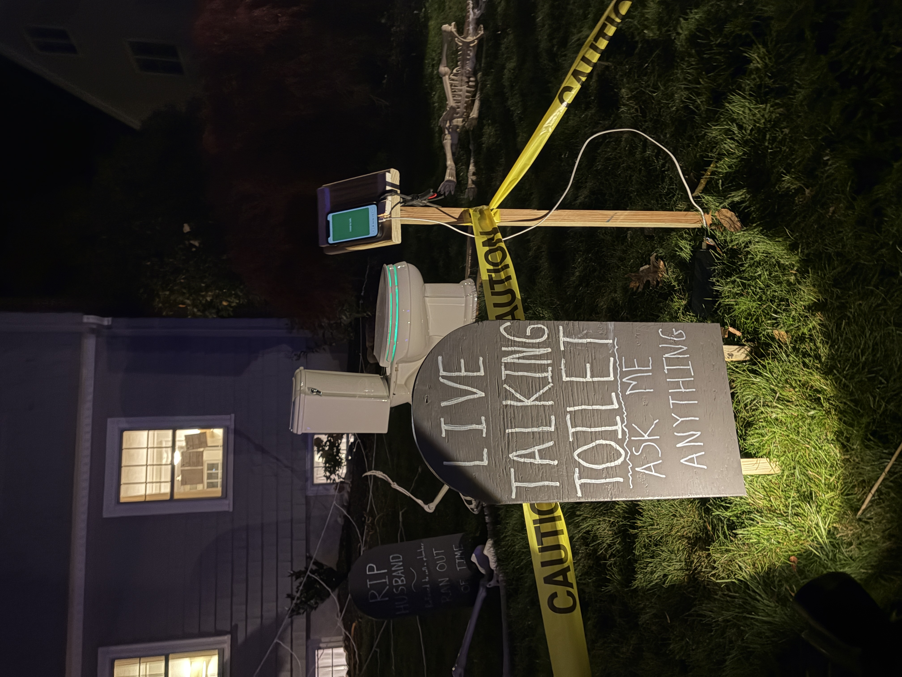
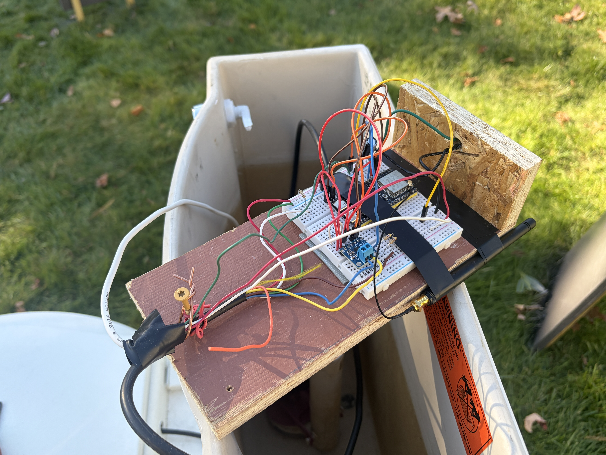
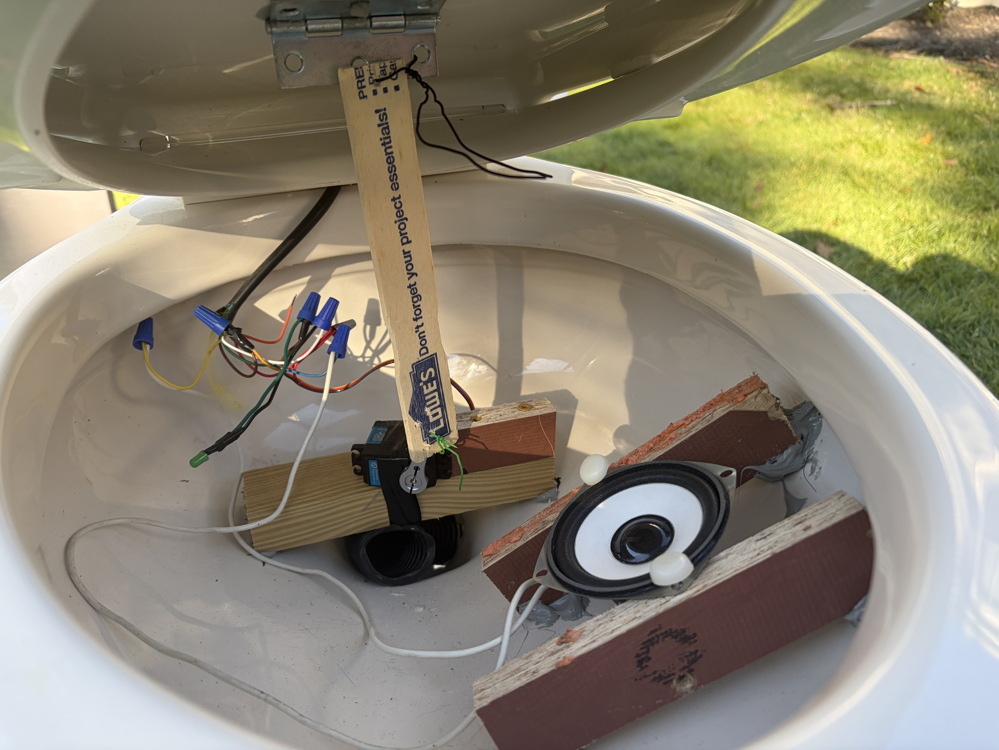
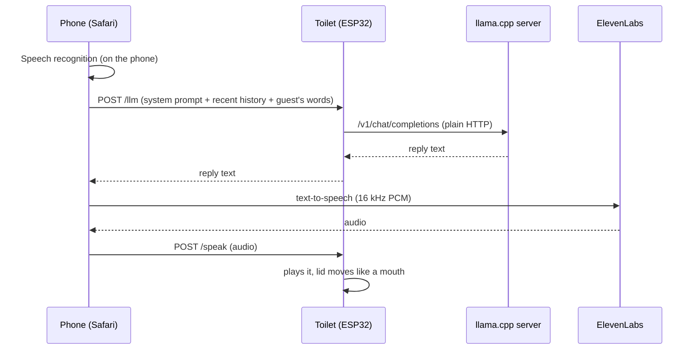

# Talking Toilet

We renovated our bathrooms in 2026, and I had an old toilet laying around. Halloween was just around the corner, so before I trashed it, I turned it into an interactive Halloween prop that would converse with trick-or-treaters.

It worked like this:

- A range finder waited for people to pass by on the sidewalk, which triggered a burp, scream or a "bro, come talk to me."

- An old iPhone attached to a stand near the toilet served as a microphone so people to talk to the toilet and get back a response.

Thanks to Claude, I was able to complete this project in two weeks. It was a huge hit on Halloween.

[Click here to see the toilet in action!](./docs/talking-toilet-reel.mp4)



## Hardware

| Part | Job | Connection |
|---|---|---|
| ESP32-S3 dev board (N16R8: 16 MB flash, 8 MB PSRAM) | Runs everything; its RGB LED shows green while burping and blue while talking | |
| Hobby servo | Lifts the lid | Signal on GPIO 7, power from the 5 V supply |
| MAX98357A I2S amplifier and speaker | Plays sounds and speech | BCLK GPIO 4, LRC GPIO 5, DIN GPIO 6; GAIN and SD tied to 5 V |
| Sharp GP2Y0A21 IR distance sensor | Detects guests from 10 to 80 cm | Output on GPIO 8, power from 5 V |
| 5 V supply | Powers the servo, amplifier and sensor | |

Pins are set in [constants.h](burping_toilet/constants.h). The sensor must stay on an ADC1 pin (GPIO 1–10), because ADC2 can't be used while Wi-Fi is on.

### Wiring notes

- **Sensor noise:** the GP2Y0A21 fires its IR LED in strong current pulses, which puts noise on its output. Put a 10–100 µF capacitor across its red (Vcc) and black (GND) wires, right at the sensor. For more filtering, add a 470 Ω resistor in series on the output wire with a 1–10 µF capacitor from GPIO 8 to ground.
- **Speech crackle:** the servo's 50 Hz signal on GPIO 7 sits next to the I2S pins and can couple into the audio. A series resistor of a few hundred ohms on the servo signal helps; so does moving the servo to a pin farther away, such as GPIO 21. Avoid GPIO 35–37, which the PSRAM uses.
- **Static instead of sound** usually means a loose DIN jumper.




<br />
<br />



## Software

### Firmware ([burping_toilet/](burping_toilet/))

An Arduino sketch for the ESP32 Arduino core 3.x.

| File | Contents |
|---|---|
| [burping_toilet.ino](burping_toilet/burping_toilet.ino) | Main sketch: sensor, lid, audio, web servers, OTA |
| [constants.h](burping_toilet/constants.h) | Everything you might tune: pins, lid angles and speeds, trigger distances, mouth movement, speech volume, server URLs |
| [page.h](burping_toilet/page.h) | The web pages (HTML, CSS and JavaScript as C string literals) |
| `burp.h`, `goat.h`, `come_talk.h` | Sound clips embedded as WAV byte arrays |
| [sound.h](burping_toilet/sound.h) | The `Sound` and `Speech` types |
| [httpd_stream.h](burping_toilet/httpd_stream.h) | Helper for streaming request bodies on the HTTPS server |
| `secrets.h` | Wi-Fi name and password, API keys (not committed with real values) |
| `cert.h` | HTTPS certificate and private key (git-ignored) |

How the firmware is organized:

- **Main loop:** checks the sensor, runs queued commands from the web pages, plays queued speech, and handles HTTP and OTA requests.
- **Lid task:** a FreeRTOS task on core 1 that steps the servo toward a target angle at a set speed. Because it runs on its own, the lid can move while audio plays.
- **Audio:** sound clips play from flash at 16 kHz. Speech goes through a compressor to even out its volume, and its loudness drives the lid angle to make the mouth move.
- **Sensor:** each reading is the median of 16 ADC samples. A running median of the last 5 readings smooths the result. A burp needs 3 close readings in a row and is followed by a 20 s cooldown. After a burp, the toilet waits until nobody is in range before it can trigger again. Readings taken while the lid is moving are ignored.
- **Web servers:**
  - Plain HTTP on port 80, for the debug page and redirects.
  - HTTPS on port 443, which iOS Safari requires before a page can use the microphone. Commands from the HTTPS server's task are handed to the main loop through FreeRTOS queues.
- **Networking:** the toilet is reachable as `burpingtoilet.local` through mDNS, and accepts firmware uploads over Wi-Fi (OTA). Burping still works if Wi-Fi is down.

### HTTP Endpoints

| URL | Page |
|---|---|
| `/` | One big **Hold to Talk** button, for handing to guests |
| `/talk` | The full talk page: transcript, timing, and settings (system prompt, voice, speed, model) |
| `/debug` (HTTP or HTTPS) | Remote control: open and close the lid, burp, pause the sensor, see live distance |

Talk-page settings are saved in the phone's browser storage.

### Talk mode



1. **Hearing:** the phone's own speech recognition (`webkitSpeechRecognition`) turns the guest's words into text while **Talk** is held.
2. **Thinking:** the page sends the system prompt, the last 10 messages and the new text to the toilet's `/llm` endpoint. The toilet relays it to a llama.cpp server on the home network. The relay is needed because a page served over HTTPS can't call a plain-HTTP server directly.
3. **Speaking**, with the voice chosen in settings:
   - **ElevenLabs (default):** the phone calls the ElevenLabs API, then uploads the audio to the toilet's `/speak`. The phone makes the call because the ESP32 doesn't have enough internal RAM for an outgoing TLS connection while its HTTPS server is running.
   - **Local Kokoro:** the phone sends the text to `/say`. The toilet requests the audio from a Kokoro-FastAPI server over plain HTTP and plays it as it streams in.

The talk page shows how long each step took: **Reply** (the LLM), **Voice** (text-to-speech and transfer) and **First words after** (the total from releasing **Talk** to the toilet speaking).

## Setup

### Requirements

- **Arduino IDE 2** with the **esp32 board package 3.x** and the **ESP32Servo** library.
- **Board settings:** ESP32S3 Dev Module, Flash Size 16 MB, PSRAM "OPI PSRAM", Partition Scheme "16M Flash (3MB APP/9.9MB FATFS)".
- **A llama.cpp server** on the network, listening on all interfaces:

  ```
  llama-server -m model.gguf --host 0.0.0.0 --port 8080
  ```

- **An ElevenLabs API key**, or a **Kokoro-FastAPI server** for local text-to-speech.
- **[mkcert](https://github.com/FiloSottile/mkcert)**, to make the HTTPS certificate.

### Configuration

1. **Fill in `secrets.h`:** `WIFI_SSID`, `WIFI_PASSWORD`, `ELEVENLABS_API_KEY`, and optionally `LOCAL_LLM_API_KEY`. Stop git from picking up your values with:

   ```
   git update-index --skip-worktree burping_toilet/secrets.h
   ```

2. **Set the server URLs:** `LOCAL_LLM_URL` and `LOCAL_TTS_URL` in [constants.h](burping_toilet/constants.h).
3. **Make the certificate:**
   - Run `mkcert burpingtoilet.local`.
   - Put the certificate and key in `cert.h` as `SERVER_CERT` and `SERVER_KEY` string constants.
   - Install mkcert's root CA on the phone, then trust it under **Settings → General → About → Certificate Trust Settings**.
4. **Upload:** the first upload goes over USB; after that, the toilet shows up as a network port in the IDE.

The ElevenLabs key is handed to the talk page through `/config`, so anyone on the same Wi-Fi can read it. Keep the toilet on a private network.

### Serial commands

Open the Serial Monitor at 115200 baud and type `?` for the list.

| Command | Action |
|---|---|
| `o` / `c` | Open / close the lid |
| `a<n>` | Move the servo to angle n, e.g. `a25` |
| `s` | Play the next sound without moving the lid |
| `b` | Run the full burp sequence |
| `p` | Pause / resume the sensor (it starts paused) |
| `d` | Start / stop printing distance readings |
| `m` | Turn the talking mouth on / off |
| `k` | Turn the speech compressor on / off |
| `w` | Show Wi-Fi status |

### Adding a sound

Sounds must be mono, 16-bit, 16 kHz WAV files. On macOS:

```
afconvert -f WAVE -d LEI16@16000 -c 1 --mix in.mp3 name.wav
xxd -i name.wav > burping_toilet/name.h
```

Then:
- Mark the array in the generated header `const`.
- `#include` it in the sketch.
- Add an entry to the `sounds[]` list in [burping_toilet.ino](burping_toilet/burping_toilet.ino).

Source MP3s live in [sounds/](sounds/).
